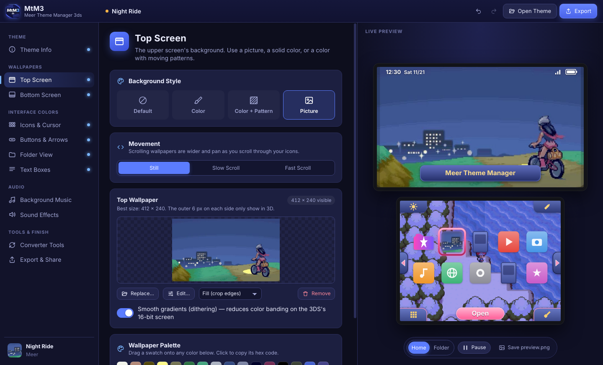
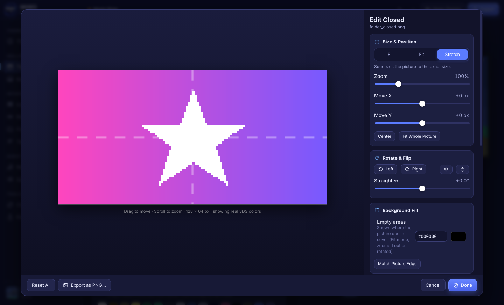
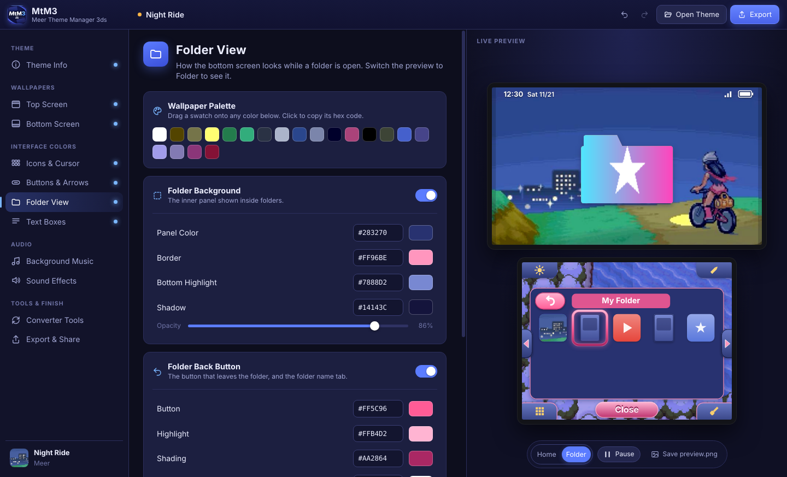
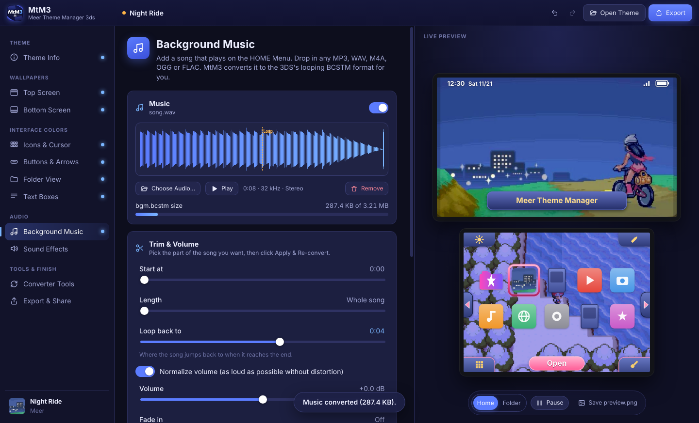
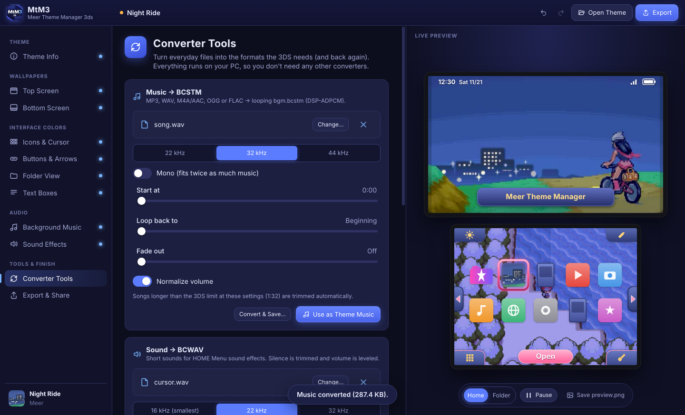
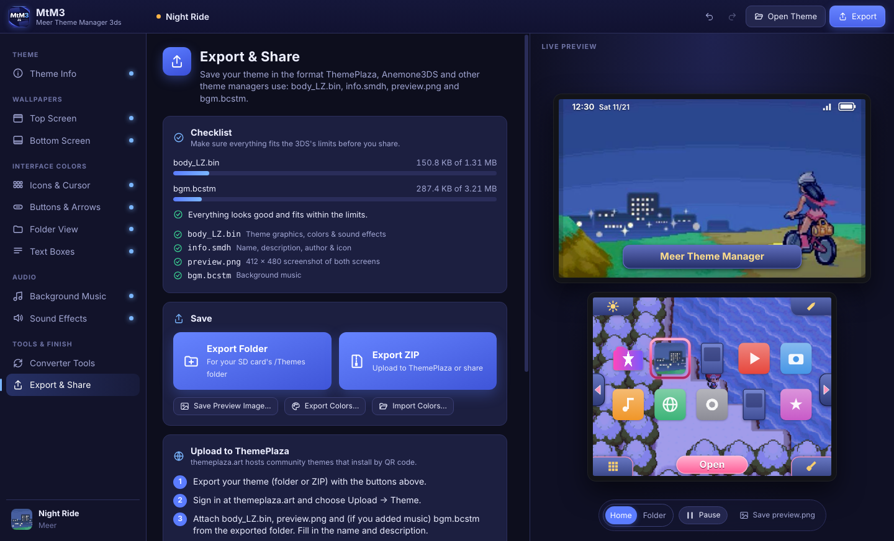

<p align="center">
  
</p>

<h1 align="center">Meer Theme Manager 3ds (MtM3)</h1>

<p align="center">
  <b>Make your own Nintendo 3DS HOME Menu themes — wallpapers, colors, music and sounds — and export them ready for ThemePlaza, Anemone3DS and CHMM2.</b>
</p>

<p align="center">
  <a href="https://github.com/meerok/MeerThemeManager3ds/releases/latest"></a>
  <a href="#macos"></a>
  
</p>

<p align="center">
  
</p>

MtM3 turns ordinary pictures and songs into a real 3DS theme. Drop in a PNG or JPG and it is resized, cropped and converted to the console's texture format. Drop in an MP3 and it becomes a looping `bgm.bcstm`. Everything else — `body_LZ.bin`, `info.smdh`, `preview.png` — is generated for you, and a live, animated preview shows exactly what you'll see on your 3DS while you work.

No other tools are needed: no LoopingAudioConverter, no image resizers, no SMDH makers.

---

## Contents

- [Features](#features)
- [Download & install](#download--install)
- [How to Use](#how-to-use)
  - [1. Start a theme](#1-start-a-theme)
  - [2. Top screen](#2-top-screen)
  - [3. Bottom screen](#3-bottom-screen)
  - [4. The image editor](#4-the-image-editor)
  - [5. Icons, cursor and interface colors](#5-icons-cursor-and-interface-colors)
  - [6. Background music](#6-background-music)
  - [7. Sound effects](#7-sound-effects)
  - [8. Converter tools](#8-converter-tools)
  - [9. Export, install and share](#9-export-install-and-share)
- [3DS limits & file formats](#3ds-limits--file-formats)
- [Troubleshooting / FAQ](#troubleshooting--faq)
- [Keyboard shortcuts](#keyboard-shortcuts)
- [Building from source](#building-from-source)
- [Project layout](#project-layout)
- [Credits & license](#credits--license)

---

## Features

| | |
|---|---|
| 🖼️ **Wallpapers** | Top screen: default, solid color with gradient, color + two moving patterns, or a picture (still, slow scroll, fast scroll). Bottom screen: default, recolored panels, or a picture (still, slow/fast scroll, page flip, bounce). |
| ✂️ **Built-in image editor** | Drag to position, scroll/pinch to zoom, Fill / Fit / Stretch, rotate 90°, straighten ±45°, flip, background fill, brightness, contrast, saturation, hue, warmth, sharpen, blur, vignette and presets — previewed in **real 3DS 16-bit color** with on-screen guides. |
| 🎨 **Every interface color** | Cursor, folders, files, arrow buttons, arrows, Open/Close buttons, top/bottom corner buttons, folder view, software title box and demo text — each with plain-English labels, hex codes and a draggable palette taken from your wallpapers. |
| 📁 **Folder & file art** | Put your own pictures on the 3D folder (open/closed) and file icons. |
| 🎵 **MP3 → BCSTM built in** | MP3, WAV, M4A/AAC, OGG and FLAC become a looping `bgm.bcstm` (DSP-ADPCM). Trim, loop point, volume, normalize, fades and quality/size control. Songs that are too long are trimmed automatically to fit. |
| 🔊 **Sound effects** | Eight HOME Menu sound slots. Any short audio file is trimmed, leveled and converted to BCWAV. |
| 🔁 **Converter tools** | Music → BCSTM, Sound → BCWAV, BCSTM/BCWAV → WAV, a picture resizer for every theme size, and a theme extractor that pulls the art, music and colors out of any theme. |
| 👀 **Live preview** | Animated top and bottom screens (scrolling wallpapers, pulsing cursor, page flips), with Home and Folder views. |
| 📦 **One-click export** | Theme folder or `.zip` with `body_LZ.bin`, `info.smdh`, `preview.png` (412 × 480) and `bgm.bcstm`, checked against the 3DS size limits. Send straight to CHMM2 over Wi-Fi. |
| ♻️ **Edit existing themes** | Open any theme folder, `.zip` or `body_LZ.bin` (for example one downloaded from ThemePlaza) and change it. |
| ↩️ **Undo/redo, color presets** | Full undo history; save and load your color schemes as JSON. |

---

## Download & install

### Windows

1. Go to **[Releases](https://github.com/meerok/MeerThemeManager3ds/releases/latest)** and download `MtM3-2.0.0-Windows-x64.zip`.
2. Right-click the zip → **Extract All…**
3. Open the extracted `MtM3` folder and double-click **`MtM3.exe`**.

> **"Windows protected your PC"?** MtM3 isn't code-signed (certificates cost money), so SmartScreen warns about it the first time. Click **More info → Run anyway**.

Requires Windows 10 or 11 (64-bit). Nothing else to install.

### macOS

The macOS version is a native SwiftUI app with the same features. It's currently distributed as source code in [`macos/`](macos):

```bash
cd macos
./build_app.sh
open "build/Meer Theme Manager 3ds.app"
```

Requires macOS 14 or newer and Xcode (or the Xcode Command Line Tools). See [Building from source](#building-from-source).

### What you need on your 3DS

To install custom themes you need a 3DS with custom firmware (for example Luma3DS) and a theme manager — **[Anemone3DS](https://github.com/astronautlevel2/Anemone3DS)** is the most popular. See [3ds.hacks.guide](https://3ds.hacks.guide/) if you haven't set this up yet.

---

## How to Use

The window has three parts:

- **Sidebar (left)** — every part of the theme, grouped as *Theme*, *Wallpapers*, *Interface Colors*, *Audio* and *Tools & Finish*. A blue dot means you've customized that part.
- **Editor (middle)** — the settings for the selected part.
- **Live Preview (right)** — your theme on both 3DS screens, updating instantly. Switch between **Home** and **Folder** view, pause the animation, or save `preview.png`.

### 1. Start a theme

Open **Theme Info** and fill in the **name**, **description** and **author**. These go into `info.smdh`, which Anemone3DS and ThemePlaza display. Drop any picture onto the **Theme Icon** box; it's shrunk to 48 × 48 (and 24 × 24) for you. You can also click **Use Top Wallpaper** to build the icon from your wallpaper.


> To edit an existing theme instead, use **Open Theme** (top-right) or **File → Open Theme Folder…**, or just drag a theme folder, `.zip` or `body_LZ.bin` onto the window.

### 2. Top screen

Pick a **Background Style**:

| Style | What it does |
|---|---|
| **Default** | Keeps Nintendo's standard background. |
| **Color** | A solid color with an adjustable glow (gradient strength and brightness). |
| **Color + Pattern** | A solid color with one or two 64 × 64 grayscale patterns that tile and drift across the screen. White parts of the pattern show, black parts are see-through. |
| **Picture** | Your own wallpaper. |

For **Picture**, choose the **Movement**:

- **Still** — one screen. Best picture size: **412 × 240** (the outer 6 px on each side only appear with the 3D slider on).
- **Slow / Fast Scroll** — a wide panorama that pans as you scroll your icons. Best size: **1008 × 240**.

Drop any picture onto the wallpaper box. It's fitted automatically — you don't need to resize it first. Leave **Smooth gradients (dithering)** on to avoid color banding on the 3DS's 16-bit screen.

The **Wallpaper Palette** card shows the main colors of your wallpapers. Drag a swatch onto any color row on any page to use it, or click it to copy the hex code.

### 3. Bottom screen


- **Default** — Nintendo's standard look.
- **Colors** — recolor the **Inner Panel** (the rounded area behind the icons) and the **Outer Frame**.
- **Picture** — your own wallpaper, with five movement types:

| Movement | Behavior | Best picture size |
|---|---|---|
| Still | Doesn't move | 320 × 240 |
| Slow Scroll / Fast Scroll | Pans smoothly with your icons | 1008 × 240 |
| Page Flip | Jumps one screen at a time across 3 screens | 960 × 240 (three 320 × 240 screens side by side) |
| Bounce | Like Page Flip, but bounces back from the last screen | 960 × 240 |

### 4. The image editor

Click any picture (or its **Edit…** button) to open the editor. It shows your picture at the exact size it will be on the console, in **real 3DS colors**, so there are no surprises.


| Tool | How to use it |
|---|---|
| **Move** | Drag the picture, or use the *Move X / Move Y* sliders. **Center** resets the position. |
| **Zoom** | Scroll the mouse wheel over the picture, pinch on a trackpad, or use the *Zoom* slider (10 %–400 %). |
| **Fill / Fit / Stretch** | *Fill* covers the whole area (edges may be cropped). *Fit* shows the whole picture with a background color around it. *Stretch* squeezes it to the exact size. |
| **Rotate & Flip** | Rotate 90° left/right, straighten by up to ±45°, and flip horizontally or vertically. |
| **Background Fill** | The color used where the picture doesn't reach. **Match Picture Edge** picks one from your picture automatically. |
| **Color** | Brightness, contrast, saturation, hue, warmth, sharpen, blur and vignette, plus quick **Vivid / Soft / Dim / B&W** presets. Double-click any value to reset it. |
| **Preview** | *Show real 3DS colors* simulates the 16-bit screen. *Show screen guides* draws the 3D-only edges, the first/last screen of scrolling wallpapers, each page of page-flip wallpapers and where the icon panel sits. |
| **Export as PNG…** | Saves the edited picture at its exact 3DS size. |

Changes appear in the live preview as you edit. **Done** keeps them, **Cancel** puts everything back.

Small pictures (folder and file art, patterns) open in the same editor, zoomed in so you can see every pixel:



### 5. Icons, cursor and interface colors

Every color group has a switch. When it's **off**, the 3DS uses its standard colors; turn it **on** to customize. Each color has a hex field and a color picker, and you can drop palette swatches onto it.


| Page | What you can change |
|---|---|
| **Icons & Cursor** | The selection **cursor** (main, light edge, shading, glow), **3D folder** colors, **folder pictures** (closed + open, 128 × 64 each), **3D file** colors, and **file pictures** (large 64 × 128 + small 32 × 64). |
| **Buttons & Arrows** | The **arrow buttons** on the screen edges, the **arrows** inside them, the **Open** and **Close** buttons (button, pressed, highlight, glow, shadow, text colors and text-shadow offset), and the **top** and **bottom corner buttons**. |
| **Folder View** | The **folder background** panel and the **folder back button** / name tab shown inside folders. Switch the preview to **Folder** to see them. |
| **Text Boxes** | The **software title box** on the top screen (*Default*, *Custom Colors* or *Hidden* to keep your wallpaper clear) and the **demo text** box. |

 

Shadows have an **Opacity** slider as well as a color.

### 6. Background music

Drop a song onto **Background Music**. MP3, WAV, M4A/AAC, OGG and FLAC all work, and so does an existing `.bcstm`, which is used as-is. MtM3 converts the song to a looping DSP-ADPCM `bgm.bcstm`, the format the 3DS needs.



- **Play** previews the converted audio, looping just like the 3DS does.
- **Trim & Volume:**
  - **Start at** skips an intro.
  - **Length** keeps only part of the song.
  - **Loop back to** sets where the song restarts after it ends; the orange marker on the waveform shows the loop point.
  - **Normalize** makes the song as loud as possible without distortion. **Volume** adds gain from −12 to +12 dB.
  - **Fade in / Fade out** smooth the start and end. A fade-out helps songs that don't loop cleanly.
  - **Remove silence** cuts quiet lead-ins and tails.
- **Quality:** 22, 32 (recommended) or 44 kHz, stereo or mono. The page tells you how many minutes fit. The 3DS music limit is about **3.2 MB** — roughly 1½ minutes of stereo at 32 kHz, or 3 minutes in mono. Anything longer is trimmed automatically.
- Click **Apply & Re-convert** after changing settings. The size bar shows how close you are to the limit.

### 7. Sound effects

Drop short sounds onto any of the eight slots: **Cursor Move**, **Launch Software**, **Open Folder**, **Close Folder**, three **Scroll Sounds** and **Open Lid / Wake**. Each sound is trimmed (silence removed, 4 seconds max), leveled and converted to BCWAV. All eight together must fit in about **187 KB**, and the size bar tracks this for you.


> Sound effects are stored inside `body_LZ.bin`, so they install with the theme. They're an advanced feature (Usagi's editor labelled them experimental), so test your theme on your console before sharing it.

### 8. Converter tools

The **Converter Tools** page works on its own, so you can use it even if you make themes elsewhere.



| Tool | Input → Output |
|---|---|
| **Music → BCSTM** | MP3 / WAV / M4A / OGG / FLAC → looping `bgm.bcstm`, with quality, mono, start, loop point, fade-out and normalize. **Use as Theme Music** sends it straight to the music page. |
| **Sound → BCWAV** | Any short sound → `.bcwav` (16, 22 or 32 kHz). |
| **BCSTM / BCWAV → WAV** | Turns 3DS audio back into a normal WAV, with a Play button to listen first. |
| **Picture Resizer** | Any picture → an exact theme size (412 × 240, 1008 × 240, 320 × 240, 960 × 240, 128 × 64, 64 × 128, 32 × 64, 48 × 48 or 64 × 64) with Fill/Fit/Stretch. **Save PNG…** or **Use in Theme**. |
| **Extract a Theme** | Any theme folder / `.zip` / `body_LZ.bin` → `top.png`, `bottom.png`, folder/file art, `icon.png`, `preview.png`, `bgm.wav`, `sfx_*.wav` and `colors.json`. Great for learning from other themes or recovering your own artwork. |

### 9. Export, install and share

Open **Export & Share**. The **Checklist** shows each file's size against the 3DS limits and warns about anything missing, such as a theme name or music that's switched on but not added.



- **Export Folder** creates a folder named after your theme containing:
  ```
  Night Ride/
  ├── body_LZ.bin   ← graphics, colors and sound effects (LZ11-compressed)
  ├── info.smdh     ← name, description, author, icon
  ├── preview.png   ← 412 × 480 picture of both screens
  └── bgm.bcstm     ← background music (if added)
  ```
- **Export ZIP** saves the same files in a `.zip`.
- **Save Preview Image**, **Export Colors** and **Import Colors** (reuse a color scheme on another theme) are also here and in the File menu.

**Install with Anemone3DS:** copy the exported folder (or `.zip`) into the **`/Themes`** folder on your SD card, put the card back in, open Anemone3DS, select your theme and install it. Use the normal install (not a "no BGM" option) if you want the music.

**Send over Wi-Fi (CHMM2):** open CHMM2 on your 3DS, choose to receive a theme, type the IP address it shows into MtM3, and click **Send**.

**Upload to ThemePlaza:**
1. Export your theme.
2. Sign in at [themeplaza.art](https://themeplaza.art/themes) and choose **Upload → Theme**.
3. Attach `body_LZ.bin`, `preview.png` and (if you added music) `bgm.bcstm`, and fill in the name and description.
4. Once it's approved, anyone can install it by scanning its QR code with Anemone3DS.

This is the exported `preview.png` for the theme shown in these screenshots:


---

## 3DS limits & file formats

| File | Limit | Notes |
|---|---|---|
| `body_LZ.bin` | **1,376,256 bytes** (0x150000) compressed | Wallpapers, pictures, colors and sound effects, LZ11-compressed. Simple artwork compresses best. |
| `bgm.bcstm` | **3,371,008 bytes** (0x337000) | DSP-ADPCM, looping. MtM3 aligns the loop point to the 14,336-sample block size for seamless loops. |
| Sound effects | **187,392 bytes** (0x2DC00) in total | Eight BCWAV files inside `body_LZ.bin`. |
| `info.smdh` | 14,016 bytes | 16 language titles (MtM3 fills all with your text), 24 × 24 and 48 × 48 RGB565 icons. |
| `preview.png` | 412 × 480 | Top screen (412 × 240) above the bottom screen (320 × 240, centered). |

| Picture | Texture size | Visible size | Format |
|---|---|---|---|
| Top, still | 512 × 256 | 412 × 240 | RGB565 |
| Top, scrolling | 1024 × 256 | 1008 × 240 | RGB565 |
| Bottom, still | 512 × 256 | 320 × 240 | RGB565 |
| Bottom, page flip / bounce | 1024 × 256 | 960 × 240 | RGB565 |
| Bottom, scrolling | 1024 × 256 | 1008 × 240 | RGB565 |
| Top patterns | 64 × 64 | 64 × 64 | A8 (grayscale) |
| Folder (open / closed) | 128 × 64 | 128 × 64 | BGR888 |
| File (large / small) | 64 × 128 / 32 × 64 | same | BGR888 |

The full technical description of every file MtM3 writes is in **[docs/FILE-FORMATS.md](docs/FILE-FORMATS.md)**.

---

## Troubleshooting / FAQ

**Windows says "Windows protected your PC".**
The app isn't code-signed. Click **More info → Run anyway**.

**My theme installs but there's no music.**
Make sure the switch on the Music card is on (the Export checklist lists `bgm.bcstm` when it's included) and that your theme manager installs the theme *with* BGM. Music must be under the 3.2 MB limit.

**"body_LZ.bin is too big".**
Busy photos with lots of noise compress poorly. Try a *Still* wallpaper instead of a scrolling one, a simpler picture, a little **Blur** in the image editor, or fewer and shorter sound effects.

**The music was cut short.**
The 3DS only allows about 3.2 MB of music. Switch to **Mono** or **22 kHz** to fit about twice as much, or use **Start at / Length** to choose the best part.

**My MP3 won't import.**
Make sure it isn't DRM-protected. If one file won't import, convert it to WAV with any audio app and try again.

**Colors look different on the 3DS.**
The 3DS screen uses 16-bit color. Turn on **Show real 3DS colors** in the image editor to see the exact result, and keep **dithering** on for smooth gradients.

**Can I edit a theme I downloaded from ThemePlaza?**
Yes. Drag its `.zip` onto MtM3 (or use *Open Theme*). Wallpapers, colors, the icon, sound effects and the music all load.

**Where do I report a bug?**
Open an [issue](https://github.com/meerok/MeerThemeManager3ds/issues) and attach the theme if you can.

---

## Keyboard shortcuts

| Action | Windows | macOS |
|---|---|---|
| New theme | Ctrl + N | ⌘ N |
| Open theme folder | Ctrl + O | ⌘ O |
| Open theme file (.zip / .bin) | Ctrl + Shift + O | — |
| Export folder | Ctrl + S | ⌘ S |
| Export ZIP | Ctrl + Shift + S | ⇧ ⌘ S |
| Undo / Redo | Ctrl + Z / Ctrl + Y | ⌘ Z / ⇧ ⌘ Z |
| Play / pause preview | Ctrl + Alt + P | ⌥ ⌘ P |
| Home / Folder preview | Ctrl + Alt + F | ⌥ ⌘ F |
| Image editor: Done / Cancel | Enter / Esc | Return / Esc |

---

## Building from source

### Windows app (Electron)

Requires [Node.js](https://nodejs.org/) 18 or newer.

```bash
cd windows
npm install
npm start               # run the app
npm test                # verify the theme engine against reference test vectors
npm run package-win     # build dist/MtM3-win32-x64/MtM3.exe (works on Windows, macOS or Linux)
```

### macOS app (SwiftUI)

```bash
cd macos
./build_app.sh          # builds "build/Meer Theme Manager 3ds.app" and build/mtm3-cli
```

You can also open `macos/Package.swift` in Xcode and run the **MtM3** scheme. `mtm3-cli` converts audio and inspects themes from Terminal:

```bash
./build/mtm3-cli bgm song.mp3 bgm.bcstm --rate 32000 --loop-start 4.5
./build/mtm3-cli sfx click.wav cursor.bcwav
./build/mtm3-cli info "My Theme.zip"
```

---

## Project layout

```
MtM3/
├── windows/                 Windows app (Electron)
│   ├── src/engine/themekit.js   theme engine: LZ11, textures, body_LZ.bin, SMDH,
│   │                            DSP-ADPCM, BCSTM, BCWAV, ZIP, audio editing
│   ├── src/renderer/            user interface, live preview, image editor, converters
│   ├── src/main.js, preload.js  window, menus, file access, CHMM2 sender
│   ├── test/                    engine tests + reference vectors
│   └── scripts/package-win.js   builds MtM3.exe (icon + version info set without Wine)
├── macos/                   macOS app (SwiftUI) + ThemeKit Swift package + mtm3-cli
├── sample-theme/            "Neon Sunset" — an example theme made with MtM3, plus its source art & audio
└── docs/                    screenshots, logo, file-format reference
```

Both apps share the same engine design. `npm test` checks the JavaScript engine byte-for-byte against reference vectors from an independent implementation of the same engine.

---

## Credits & license

- File formats follow **[Usagi 3DS Theme Editor](https://github.com/usagirei/3DS-Theme-Editor)** (MIT, Usagirei) and **[3dbrew](https://www.3dbrew.org/wiki/Home_Menu/Themes)**.
- The DSP-ADPCM encoder is a port of the one in **[VGAudio](https://github.com/Thealexbarney/VGAudio)** (MIT, Alex Barney).
- Sample theme art and music were made for this project.
- Nintendo 3DS is a trademark of Nintendo. MtM3 is an independent fan tool and isn't affiliated with or endorsed by Nintendo or ThemePlaza.

MtM3 is released under the **[MIT License](LICENSE)**. Made by **Meer**.
