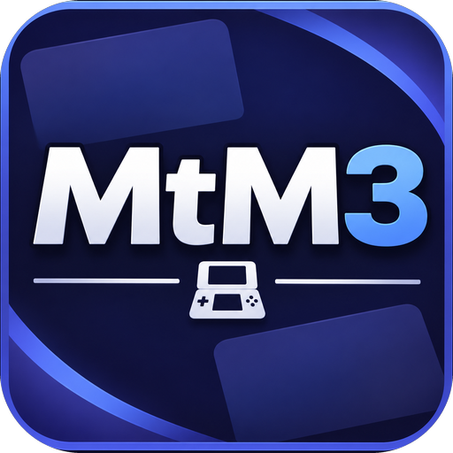
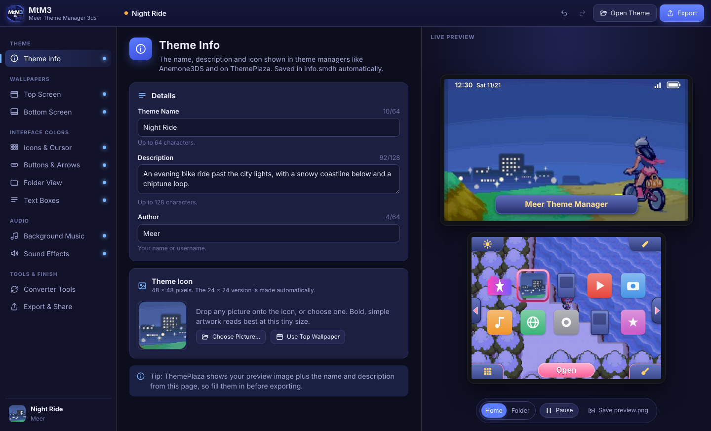
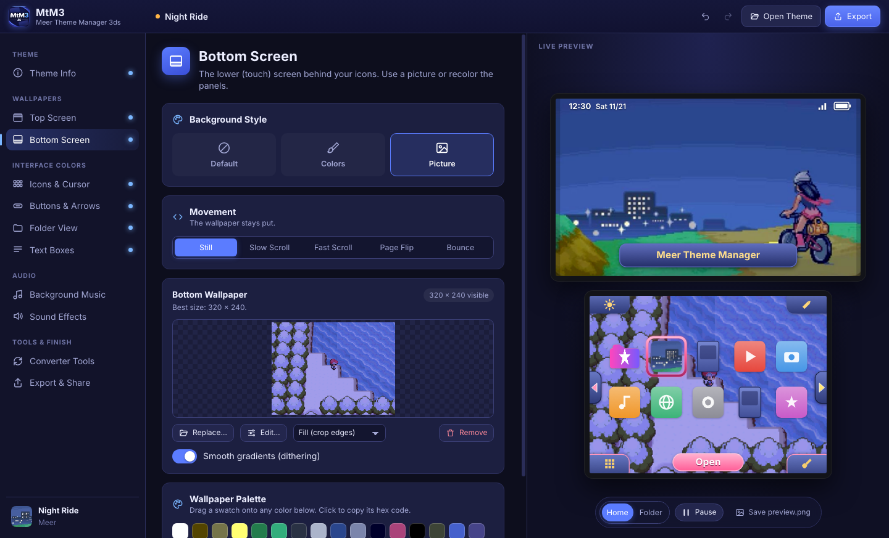
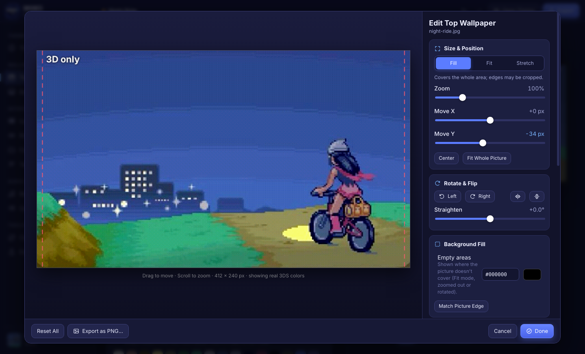
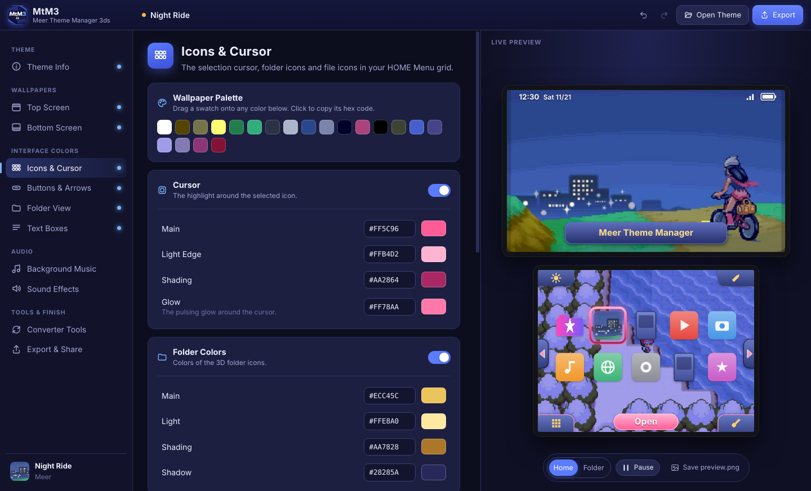
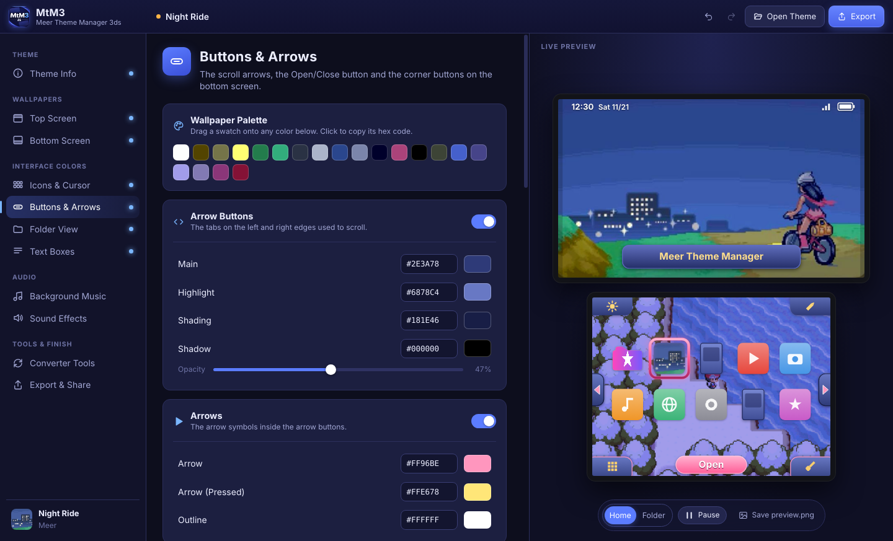
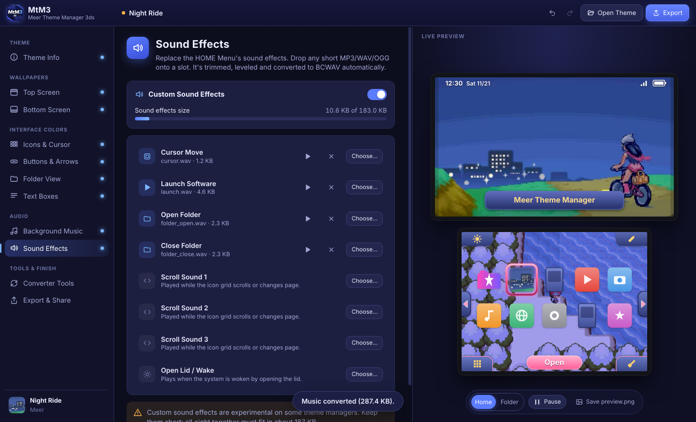
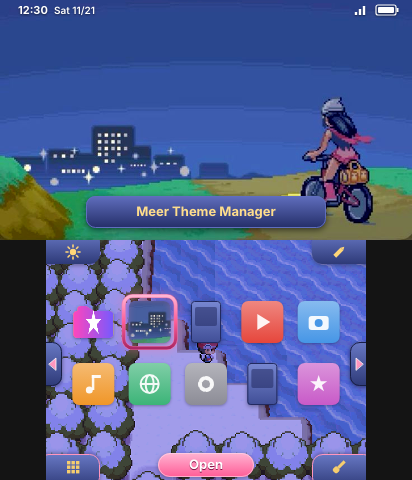

<p align="center">
  
</p>

<h1 align="center">Meer Theme Manager 3ds (MtM3)</h1>

<p align="center">
  <b>A theme maker for the Nintendo 3DS HOME Menu. Wallpapers, colors, music and sound effects, exported in the format ThemePlaza, Anemone3DS and CHMM2 use.</b>
</p>

<p align="center">
  <a href="https://github.com/meerok/MeerThemeManager3ds/releases/latest"></a>
  <a href="https://github.com/meerok/MeerThemeManager3ds/releases/latest"></a>
  <a href="https://github.com/meerok/MeerThemeManager3ds/releases/latest"></a>
  
</p>

<p align="center">
  
</p>

I made MtM3 because putting a 3DS theme together usually means juggling a theme editor, an audio looper and an image resizer. This does all of it in one app. You give it normal pictures and songs (PNG, JPG, MP3 and so on) and it handles the resizing, the 3DS texture format, the looping `bgm.bcstm`, `info.smdh` and `preview.png`. There's a live preview of both screens so you can see what it'll look like on the console while you edit.

It runs on **Windows, Mac and Linux**, and it's free and open source.

---

## Contents

- [Features](#features)
- [Download & install](#download--install)
- [How to Use](#how-to-use)
  - [1. Start a theme](#1-start-a-theme)
  - [2. Top screen](#2-top-screen)
  - [3. Bottom screen](#3-bottom-screen)
  - [4. The image editor](#4-the-image-editor)
  - [5. Icons, cursor and interface colors](#5-icons-cursor-and-interface-colors)
  - [6. Background music](#6-background-music)
  - [7. Sound effects](#7-sound-effects)
  - [8. Converter tools](#8-converter-tools)
  - [9. Export, install and share](#9-export-install-and-share)
- [3DS limits & file formats](#3ds-limits--file-formats)
- [Troubleshooting / FAQ](#troubleshooting--faq)
- [Keyboard shortcuts](#keyboard-shortcuts)
- [Building from source](#building-from-source)
- [Project layout](#project-layout)
- [Credits & license](#credits--license)

---

## Features

- **Wallpapers.** Top screen can be the default, a solid color with a gradient, a color with two moving patterns, or a picture (still, slow scroll or fast scroll). Bottom screen can be the default, recolored panels, or a picture (still, slow/fast scroll, page flip or bounce).
- **Image editor.** Move, zoom, fill/fit/stretch, rotate, straighten, flip, plus brightness, contrast, saturation, hue, warmth, sharpen, blur and vignette. The preview uses the 3DS's 16-bit color so you see the real result.
- **All the interface colors.** Cursor, folders, files, arrow buttons, Open/Close buttons, corner buttons, folder view, the software title box and the demo text. Each one is labelled in plain English and there's a palette pulled from your wallpapers that you can drag colors from.
- **Folder and file art.** Put your own pictures on the 3D folders and file icons.
- **Music conversion.** MP3, WAV, M4A/AAC, OGG and FLAC get turned into a looping `bgm.bcstm`. You can trim it, set the loop point, change the volume, normalize and fade. If a song is too long it gets cut to fit.
- **Sound effects.** Eight HOME Menu sound slots. Short audio files are trimmed, leveled and converted to BCWAV.
- **Converter tools.** Music to BCSTM, sounds to BCWAV, BCSTM/BCWAV back to WAV, a resizer for every theme picture size, and an extractor that pulls the art, music and colors out of an existing theme.
- **Live preview.** Both screens animate (scrolling wallpapers, the cursor pulse, page flips) and you can switch between the Home and Folder views.
- **Export.** Save a theme folder or `.zip` with `body_LZ.bin`, `info.smdh`, `preview.png` and `bgm.bcstm`. It checks everything against the 3DS size limits first. You can also send it straight to CHMM2 over Wi-Fi.
- **Edit existing themes.** Open a theme folder, `.zip` or `body_LZ.bin` (like one from ThemePlaza) and change whatever you want.
- **Undo/redo and color presets.** Full undo history, and you can save your color schemes as JSON to reuse later.

---

## Download & install

Every download is on the **[Releases page](https://github.com/meerok/MeerThemeManager3ds/releases/latest)**. Grab the one for your computer (the version number in the file name changes with each release).

| Your computer | File to download |
|---|---|
| Windows 10 or 11 (64-bit) | `MtM3-x.x.x-Windows-x64.zip` |
| Mac with Apple Silicon (M1 or newer) | `MtM3-x.x.x-macOS-AppleSilicon.zip` |
| Linux (64-bit) | `MtM3-x.x.x-Linux-x64.tar.gz` |

### Windows

1. Download the Windows zip and right-click it, then choose **Extract All…**
2. Open the `MtM3` folder and double-click **`MtM3.exe`**. There's no installer.

> If Windows shows **"Windows protected your PC"**, that's because the app isn't code-signed (the certificates cost money). Click **More info**, then **Run anyway**. You only have to do this once.

### macOS

1. Download the macOS zip and double-click it to unzip.
2. Drag **Meer Theme Manager 3ds** into your **Applications** folder.
3. The first time, **right-click** the app and choose **Open**, then click **Open** again.

> macOS will say it "can't check the app for malicious software" because it isn't signed with a paid Apple certificate. Right-clicking and choosing Open gets around it. You can also go to **System Settings > Privacy & Security** and click **Open Anyway**. You only have to do this once.

Needs macOS 14 (Sonoma) or newer. The download is for Apple Silicon Macs. If you have an older Intel Mac, you can [build it yourself](#macos-app-swiftui).

### Linux

```bash
tar -xzf MtM3-*-Linux-x64.tar.gz
cd MtM3
./mtm3
```

> If it closes straight away with a message about the "sandbox", start it with `./mtm3 --no-sandbox`. Some distros (like newer Ubuntu) block the sandbox Electron apps use by default.

### What you need on your 3DS

Custom themes need a 3DS with custom firmware (like Luma3DS) and a theme manager. **[Anemone3DS](https://github.com/astronautlevel2/Anemone3DS)** is the one most people use. If you haven't set that up yet, follow [3ds.hacks.guide](https://3ds.hacks.guide/).

---

## How to Use

The window is split into three parts:

- **Sidebar (left):** every part of the theme, grouped into *Theme*, *Wallpapers*, *Interface Colors*, *Audio* and *Tools & Finish*. A blue dot means you've changed that part.
- **Editor (middle):** the settings for whatever you picked in the sidebar.
- **Live Preview (right):** your theme on both screens. It updates as you edit. You can switch between **Home** and **Folder** view, pause the animation, or save `preview.png`.

### 1. Start a theme

Open **Theme Info** and fill in the **name**, **description** and **author**. These are saved in `info.smdh` and show up in Anemone3DS and on ThemePlaza. Drop a picture on the **Theme Icon** box and it gets shrunk to 48 × 48 (and 24 × 24). **Use Top Wallpaper** makes the icon from your wallpaper instead.



> To edit a theme you already have, click **Open Theme** in the top right, use **File > Open Theme Folder…**, or just drag the folder, `.zip` or `body_LZ.bin` onto the window.

### 2. Top screen

Pick a **Background Style**:

| Style | What it does |
|---|---|
| **Default** | Nintendo's normal background. |
| **Color** | One solid color with an adjustable glow. |
| **Color + Pattern** | A solid color with one or two 64 × 64 grayscale patterns that tile and drift across the screen. White shows up, black is see-through. |
| **Picture** | Your own wallpaper. |

If you pick **Picture**, choose how it moves:

- **Still:** one screen. Best size is **412 × 240**. The outer 6 px on each side only show when the 3D slider is up.
- **Slow / Fast Scroll:** a wide picture that pans as you scroll through your icons. Best size is **1008 × 240**.

Drop any picture on the wallpaper box and it gets fitted for you, so you don't need to resize it first. Keep **Smooth gradients (dithering)** on, otherwise gradients can look banded on the 3DS screen.

The **Wallpaper Palette** card shows the main colors in your wallpapers. Drag one onto any color row to use it, or click it to copy the hex code.

### 3. Bottom screen



- **Default:** Nintendo's normal look.
- **Colors:** recolor the **Inner Panel** (the rounded area behind the icons) and the **Outer Frame**.
- **Picture:** your own wallpaper, with five ways to move:

| Movement | What it does | Best picture size |
|---|---|---|
| Still | Doesn't move | 320 × 240 |
| Slow Scroll / Fast Scroll | Pans smoothly with your icons | 1008 × 240 |
| Page Flip | Jumps one screen at a time across 3 screens | 960 × 240 (three 320 × 240 screens side by side) |
| Bounce | Like Page Flip, but bounces back at the end | 960 × 240 |

### 4. The image editor

Click a picture (or its **Edit…** button) to open the editor. It shows the picture at the exact size it'll be on the console, using the 3DS's colors.



| Tool | How to use it |
|---|---|
| **Move** | Drag the picture or use the *Move X / Move Y* sliders. **Center** puts it back in the middle. |
| **Zoom** | Mouse wheel over the picture, pinch on a trackpad, or the *Zoom* slider (10% to 400%). |
| **Fill / Fit / Stretch** | *Fill* covers the whole area and may crop the edges. *Fit* shows the whole picture with a background color around it. *Stretch* squashes it to the exact size. |
| **Rotate & Flip** | Rotate 90° either way, straighten up to 45°, and flip horizontally or vertically. |
| **Background Fill** | The color used where the picture doesn't reach. **Match Picture Edge** picks one from the picture for you. |
| **Color** | Brightness, contrast, saturation, hue, warmth, sharpen, blur and vignette, plus **Vivid / Soft / Dim / B&W** presets. Double-click a value to reset it. |
| **Preview** | *Show real 3DS colors* simulates the 16-bit screen. *Show screen guides* marks the 3D-only edges, the screen boundaries on scrolling and page-flip wallpapers, and where the icon panel sits. |
| **Export as PNG…** | Saves the edited picture at its exact 3DS size. |

The live preview updates while you edit. **Done** keeps your changes and **Cancel** throws them away.

Small pictures like folder art and patterns open in the same editor, zoomed in so you can see each pixel:


### 5. Icons, cursor and interface colors

Each color group has an on/off switch. Off means the 3DS uses its normal colors. Turn it on to pick your own. Every color has a hex field and a color picker, and you can drop palette colors onto them.



| Page | What you can change |
|---|---|
| **Icons & Cursor** | The selection **cursor** (main color, light edge, shading, glow), **3D folder** colors, **folder pictures** (closed and open, 128 × 64 each), **3D file** colors and **file pictures** (large 64 × 128, small 32 × 64). |
| **Buttons & Arrows** | The **arrow buttons** on the screen edges, the **arrows** inside them, the **Open** and **Close** buttons (button, pressed, highlight, glow, shadow, text and text shadow), and the **top** and **bottom corner buttons**. |
| **Folder View** | The **folder background** and the **back button** / name tab you see inside a folder. Switch the preview to **Folder** to see them. |
| **Text Boxes** | The **software title box** on the top screen (*Default*, *Custom Colors*, or *Hidden* if you want your wallpaper uncovered) and the **demo text** box. |

 

Shadows have an **Opacity** slider too.

### 6. Background music

Drop a song on **Background Music**. MP3, WAV, M4A/AAC, OGG and FLAC all work. You can also use a `.bcstm` you already have and it'll be kept as is. Everything else gets converted to a looping `bgm.bcstm`, which is what the 3DS plays.


- **Play** lets you hear the converted song. It loops the same way the 3DS does.
- **Trim & Volume:**
  - **Start at** skips an intro.
  - **Length** keeps only part of the song.
  - **Loop back to** sets where the song restarts. The orange marker on the waveform shows the spot.
  - **Normalize** makes it as loud as it can go without clipping. **Volume** adds or removes up to 12 dB.
  - **Fade in / Fade out** smooth out the start and end. A fade out helps if the song doesn't loop cleanly.
  - **Remove silence** cuts quiet bits at the start and end.
- **Quality:** 22, 32 (recommended) or 44 kHz, in stereo or mono. The page tells you how many minutes will fit. The 3DS only allows about **3.2 MB** of music, which is around 1.5 minutes of stereo at 32 kHz or 3 minutes in mono. Anything longer gets cut.
- Click **Apply & Re-convert** after you change settings. The size bar shows how close you are to the limit.

### 7. Sound effects

Drop short sounds on any of the eight slots: **Cursor Move**, **Launch Software**, **Open Folder**, **Close Folder**, three **Scroll Sounds** and **Open Lid / Wake**. Each one is trimmed (silence removed, 4 seconds max), leveled and converted to BCWAV. All eight together have to fit in about **187 KB**, and the size bar keeps track.



> Sound effects are saved inside `body_LZ.bin`, so they install along with the theme. Usagi's editor marked this feature as experimental, so try your theme on your own 3DS before sharing it.

### 8. Converter tools

The **Converter Tools** page works by itself, so it's useful even if you make your themes in something else.


| Tool | What it converts |
|---|---|
| **Music to BCSTM** | MP3 / WAV / M4A / OGG / FLAC to a looping `bgm.bcstm`, with quality, mono, start, loop point, fade out and normalize. **Use as Theme Music** sends it to the music page. |
| **Sound to BCWAV** | Any short sound to `.bcwav` (16, 22 or 32 kHz). |
| **BCSTM / BCWAV to WAV** | Turns 3DS audio back into a normal WAV. There's a Play button so you can listen first. |
| **Picture Resizer** | Resizes a picture to any theme size (412 × 240, 1008 × 240, 320 × 240, 960 × 240, 128 × 64, 64 × 128, 32 × 64, 48 × 48 or 64 × 64) using Fill, Fit or Stretch. Then **Save PNG…** or **Use in Theme**. |
| **Extract a Theme** | Takes a theme folder, `.zip` or `body_LZ.bin` and saves out `top.png`, `bottom.png`, the folder/file art, `icon.png`, `preview.png`, `bgm.wav`, `sfx_*.wav` and `colors.json`. Handy if you want to see how someone else's theme was made or get your own artwork back. |

### 9. Export, install and share

Go to **Export & Share**. The **Checklist** lists each file's size next to the 3DS limit and warns you if something's missing, like a theme name, or music that's switched on but not added.


- **Export Folder** makes a folder named after your theme:
  ```
  Night Ride/
  ├── body_LZ.bin   graphics, colors and sound effects (LZ11-compressed)
  ├── info.smdh     name, description, author, icon
  ├── preview.png   412 × 480 picture of both screens
  └── bgm.bcstm     background music (if you added any)
  ```
- **Export ZIP** puts the same files in a `.zip`.
- **Save Preview Image**, **Export Colors** and **Import Colors** (for reusing a color scheme) are here and in the File menu too.

**Installing with Anemone3DS:** copy the exported folder or `.zip` into the **`/Themes`** folder on your SD card. Put the card back in, open Anemone3DS, pick your theme and install it. Use the normal install, not the "no BGM" one, if you want the music.

**Sending over Wi-Fi (CHMM2):** open CHMM2 on your 3DS and choose to receive a theme. Type the IP address it shows into MtM3 and click **Send**.

**Uploading to ThemePlaza:**
1. Export your theme.
2. Sign in at [themeplaza.art](https://themeplaza.art/themes) and go to **Upload > Theme**.
3. Attach `body_LZ.bin`, `preview.png` and `bgm.bcstm` (if you have music), then fill in the name and description.
4. After it's approved, people can install it by scanning its QR code in Anemone3DS.

Here's the exported `preview.png` for the theme in these screenshots:



---

## 3DS limits & file formats

| File | Limit | Notes |
|---|---|---|
| `body_LZ.bin` | **1,376,256 bytes** (0x150000) compressed | Wallpapers, pictures, colors and sound effects, LZ11-compressed. Simpler artwork compresses better. |
| `bgm.bcstm` | **3,371,008 bytes** (0x337000) | Looping DSP-ADPCM. MtM3 lines the loop point up with the 14,336-sample block size so the loop is seamless. |
| Sound effects | **187,392 bytes** (0x2DC00) total | Eight BCWAV files stored inside `body_LZ.bin`. |
| `info.smdh` | 14,016 bytes | 16 language titles (MtM3 puts your text in all of them) and 24 × 24 / 48 × 48 RGB565 icons. |
| `preview.png` | 412 × 480 | Top screen (412 × 240) above the bottom screen (320 × 240, centered). |

| Picture | Texture size | Visible size | Format |
|---|---|---|---|
| Top, still | 512 × 256 | 412 × 240 | RGB565 |
| Top, scrolling | 1024 × 256 | 1008 × 240 | RGB565 |
| Bottom, still | 512 × 256 | 320 × 240 | RGB565 |
| Bottom, page flip / bounce | 1024 × 256 | 960 × 240 | RGB565 |
| Bottom, scrolling | 1024 × 256 | 1008 × 240 | RGB565 |
| Top patterns | 64 × 64 | 64 × 64 | A8 (grayscale) |
| Folder (open / closed) | 128 × 64 | 128 × 64 | BGR888 |
| File (large / small) | 64 × 128 / 32 × 64 | same | BGR888 |

If you want the technical details of every file MtM3 writes, see **[docs/FILE-FORMATS.md](docs/FILE-FORMATS.md)**.

---

## Troubleshooting / FAQ

**Windows says "Windows protected your PC".**
The app isn't code-signed. Click **More info**, then **Run anyway**.

**My Mac says it can't open the app or can't check it.**
Right-click the app and choose **Open**, then click **Open** again. Or go to **System Settings > Privacy & Security** and click **Open Anyway**.

**My theme installs but there's no music.**
Check that the switch on the Music card is on (the Export checklist will list `bgm.bcstm` if it's included). Also make sure your theme manager is installing the theme *with* BGM. The music has to be under 3.2 MB.

**"body_LZ.bin is too big".**
Busy, noisy photos don't compress well. Try a *Still* wallpaper instead of a scrolling one, a simpler picture, a bit of **Blur** in the image editor, or fewer/shorter sound effects.

**The music got cut short.**
The 3DS only allows about 3.2 MB of music. Switching to **Mono** or **22 kHz** fits about twice as much, or you can use **Start at / Length** to pick the best part.

**My MP3 won't import.**
Make sure it isn't DRM-protected. If one file still won't work, convert it to WAV in any audio app and try that.

**The colors look different on my 3DS.**
The 3DS screen uses 16-bit color. Turn on **Show real 3DS colors** in the image editor to see the actual result, and leave **dithering** on for smooth gradients.

**Can I edit a theme I downloaded from ThemePlaza?**
Yes. Drag its `.zip` onto MtM3 or use *Open Theme*. The wallpapers, colors, icon, sound effects and music all load.

**Where do I report a bug?**
Open an [issue](https://github.com/meerok/MeerThemeManager3ds/issues), and attach the theme if you can.

---

## Keyboard shortcuts

| Action | Windows / Linux | macOS |
|---|---|---|
| New theme | Ctrl + N | ⌘ N |
| Open theme folder | Ctrl + O | ⌘ O |
| Open theme file (.zip / .bin) | Ctrl + Shift + O | n/a |
| Export folder | Ctrl + S | ⌘ S |
| Export ZIP | Ctrl + Shift + S | ⇧ ⌘ S |
| Undo / Redo | Ctrl + Z / Ctrl + Y | ⌘ Z / ⇧ ⌘ Z |
| Play / pause preview | Ctrl + Alt + P | ⌥ ⌘ P |
| Home / Folder preview | Ctrl + Alt + F | ⌥ ⌘ F |
| Image editor: Done / Cancel | Enter / Esc | Return / Esc |

---

## Building from source

You only need this if you want to change the code. Normal users can just grab a download from [Releases](https://github.com/meerok/MeerThemeManager3ds/releases/latest).

### Windows and Linux app (Electron)

You need [Node.js](https://nodejs.org/) 18 or newer.

```bash
cd windows
npm install
npm start               # run the app
npm test                # test the theme engine against reference files
npm run package-win     # build dist/MtM3-win32-x64/MtM3.exe (works on Windows, macOS or Linux)
```

### macOS app (SwiftUI)

You need macOS 14 or newer and Xcode (or just the Xcode Command Line Tools).

```bash
cd macos
./build_app.sh          # builds "build/Meer Theme Manager 3ds.app" and build/mtm3-cli
```

You can also open `macos/Package.swift` in Xcode and run the **MtM3** scheme. `mtm3-cli` lets you convert audio and look inside themes from Terminal:

```bash
./build/mtm3-cli bgm song.mp3 bgm.bcstm --rate 32000 --loop-start 4.5
./build/mtm3-cli sfx click.wav cursor.bcwav
./build/mtm3-cli info "My Theme.zip"
```

### How releases are built

Releases are built by GitHub, not on anyone's computer. When a new release is published, the [**Build release downloads**](.github/workflows/release.yml) workflow builds the Windows, macOS and Linux versions and attaches them to the release automatically. It can also be run by hand from the **Actions** tab to rebuild the downloads for an older release.

To make a new release:

1. Bump `version` in `windows/package.json`.
2. On GitHub, go to **Releases > Draft a new release**, create a tag like `v2.1.0` and publish it.
3. Wait a few minutes. The three downloads show up on the release by themselves.

---

## Project layout

```
MtM3/
├── windows/                 Windows and Linux app (Electron)
│   ├── src/engine/themekit.js   theme engine: LZ11, textures, body_LZ.bin, SMDH,
│   │                            DSP-ADPCM, BCSTM, BCWAV, ZIP, audio editing
│   ├── src/renderer/            UI, live preview, image editor, converters
│   ├── src/main.js, preload.js  window, menus, file access, CHMM2 sender
│   ├── test/                    engine tests and reference files
│   └── scripts/package-win.js   builds MtM3.exe (sets the icon and version info without Wine)
├── macos/                   macOS app (SwiftUI), ThemeKit Swift package and mtm3-cli
├── sample-theme/            "Neon Sunset", an example theme made with MtM3, plus its source art and audio
├── docs/                    screenshots, logo, file format reference
└── .github/workflows/       builds the Windows, macOS and Linux downloads for each release
```

The Windows and Linux app and the Mac app use the same engine design. `npm test` checks the JavaScript engine byte for byte against reference files made by a separate implementation of the engine.

---

## Credits & license

- The file formats are based on **[Usagi 3DS Theme Editor](https://github.com/usagirei/3DS-Theme-Editor)** (MIT, Usagirei) and **[3dbrew](https://www.3dbrew.org/wiki/Home_Menu/Themes)**.
- The DSP-ADPCM encoder is ported from **[VGAudio](https://github.com/Thealexbarney/VGAudio)** (MIT, Alex Barney).
- The sample theme's art and music were made for this project.
- Nintendo 3DS is a trademark of Nintendo. MtM3 is a fan-made tool and isn't affiliated with or endorsed by Nintendo or ThemePlaza.

MtM3 is released under the **[MIT License](LICENSE)**. Made by **Meer**.
